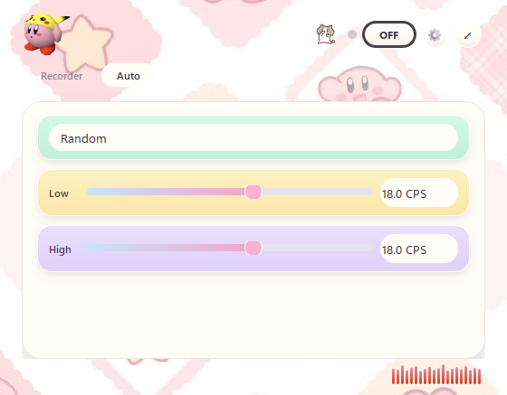
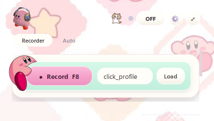
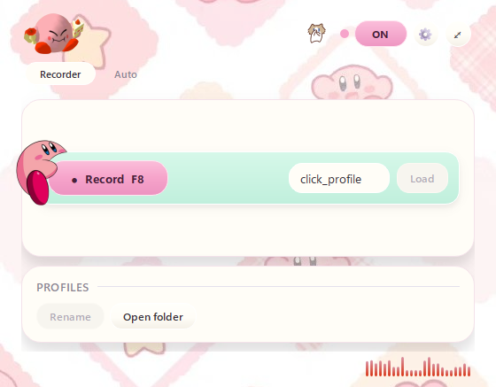
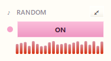
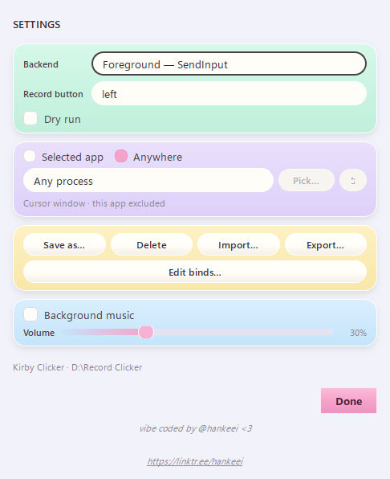

# Kirby Clicker

A Windows desktop GUI clicker with a claymorphism look and Kirby mascots. It
records real human clicks (hold time + gap time) into the ClickProfile v1 text
format and replays them with the same cadence. **Turn the clicker ON once, then
hold the mouse button to click** — releasing it stops instantly. A second tab is
a random-CPS auto-clicker with five timing methods, and the window can shrink to
a small always-on-top music-box overlay.








## Install and run

### Packaged executable (no toolchain)

Download `KirbyClicker.exe` from the repository's **Releases** page (it is not
committed to git — see *Building from source* to produce it yourself) and
double-click it (≈59 MB). It is a PyInstaller one-file, windowed build: Python,
Qt, the multimedia backend and the assets are inside the exe; no Python
installation is required. The exe carries the Kirby icon (`assets/icon.ico`);
the window, compact overlay and taskbar icon use `assets/icon.png` through Qt,
and the process sets the AppUserModelID `KirbyClicker.Desktop.1` so Windows
groups it under the app icon rather than the generic Python icon.

On first launch the app creates its data directory (see below), so it can write
even when the exe sits in a read-only or temporary folder.

### From source

Requirements: Windows 10/11, Python 3.10+ and PySide6. Clone the repository
(green **Code** button) or download the ZIP, then from its folder:

```powershell
cd "Record Clicker"
py -3.13 -m pip install -r requirements.txt
py -3.13 main.py
```

Use `py -3.13` on this machine: the plain `python` command resolves to Python
3.14, which does not have PySide6 installed.

### Where data lives

| Launch | `binds.txt`, `settings.json` and `profiles/` | Screenshots |
| --- | --- | --- |
| `py -3.13 main.py` | project root | `screenshots/` |
| `dist\KirbyClicker.exe` | `%LOCALAPPDATA%\KirbyClicker` | not written |
| any, with `KIRBYCLICKER_DATA` set | that directory | not written |

`settings.json` stores the auto-clicker bounds, button, timing method and
sigma, the active tab, the compact-mode flag, the last window geometry, the
overlay position, and the music option and volume. `binds.txt` keeps the
hotkeys, the mouse trigger, scope and target. Both are created on demand; a
corrupt or unreadable settings file falls back to defaults instead of failing
to launch.

**Renamed through Record Clicker → GMK Clicker → Kirby Clicker.** On first start
of the packaged exe, if `%LOCALAPPDATA%\KirbyClicker` does not exist, the app
copies the newest available legacy folder into it once: `GMKClicker` first, then
`RecordClicker` (binds, settings and all profiles). An existing Kirby folder is
never overwritten. The legacy `GMKCLICKER_DATA` and `RECORD_CLICKER_DATA`
environment variables are still honoured. Profile files keep the
`# ClickProfile v1` header prefix, so every old `.txt` profile still loads, and
the exchange JSON format id is unchanged.

The packaged app deliberately avoids one-file's temporary extraction folder for
user data.

### Build the executable

```powershell
powershell -ExecutionPolicy Bypass -File .\build.ps1
```

The script installs `requirements-build.txt`, then runs PyInstaller with
`--onefile --windowed --name KirbyClicker --icon assets/icon.ico
--add-data "assets;assets" --add-data "README.md;."
--collect-all PySide6.QtMultimedia --distpath dist --workpath build/work
--specpath build main.py`. `--collect-all PySide6.QtMultimedia` is required so
the FFmpeg media plugin is bundled and the song keeps playing in the frozen
build. The icon is embedded as the Windows executable resource; `assets/` and
`README.md` are extracted to `sys._MEIPASS` and located by
`app/core/paths.py`. Output:

```text
dist\KirbyClicker.exe      58 MB
build\KirbyClicker.spec    intermediate spec
build\work\              intermediate build tree (safe to delete)
```

### Application icon

| File | Purpose |
| --- | --- |
| `assets/kirby.png` | uploaded normal Kirby; icon source and recorder mascot |
| `assets/icon.ico` | 16, 24, 32, 48, 64, 128 and 256 px layers; exe resource + taskbar |
| `assets/icon.png` | 256 px, used by Qt for the window and compact overlay |
| `tools/make_icon.py` | trim transparent margins, square-crop, scale, ICO writer (Qt only, no Pillow) |

`make_icon.py` scans the PNG alpha channel, trims the empty margins, centres the
art in a transparent square and writes every ICO layer independently. Regenerate
with:

```powershell
py -3.13 tools/make_icon.py
```

### What the exe contains, and what it still needs

The bundle contains the Python 3.13 runtime, Qt 6 (`Qt6Core`, `Qt6Gui`,
`Qt6Widgets`, `Qt6Multimedia`), the Windows platform plugin, the FFmpeg
multimedia plugin, the MSVC runtime, and every asset in `assets/` including
`cat.gif` and `luolei.mp3`. The `--selftest` mode (see Verification) proves the
frozen copy loads its icon, animates the GIF and plays the song.

So neither Python nor PySide6 has to be installed. External pieces are only
Windows itself:

- **Windows 10/11 system DLLs**, including the Universal C Runtime (present by
  default) and normal `kernel32`/`user32` APIs. The Visual C++ runtime is
  bundled.
- **Unsigned exe → SmartScreen.** Windows may show “Windows protected your PC”;
  choose *More info → Run anyway*. A code-signing certificate removes this.
- **Antivirus false positives.** One-file packagers are frequently flagged by
  heuristics because the exe self-extracts; submit false positives to the vendor.
- One-file launch extracts Qt to `%TEMP%`; the first start is slower and spawns
  two processes (bootloader + app). User data stays in LocalAppData.

**Evidence and its limit:** this machine has Python installed, so a genuinely
clean-VM test was not possible. The closest available test launched
`dist\KirbyClicker.exe` with `PATH` reduced to `%SystemRoot%\System32` and
`PYTHONHOME`, `PYTHONPATH`, `PYTHONSTARTUP` and `VIRTUAL_ENV` removed:
`--selftest` reported a valid 28-frame GIF and audio actually playing at 5 %
volume (position 2352 ms), the window opened with the title `Kirby Clicker`,
both segments were enumerated through UI Automation, and the settings dialog
opened. `python` was not resolvable on the stripped `PATH`. That shows the exe
does not fall back to the installed interpreter, but it is not the same as
running on a machine that never had Python.

## How to use it

The app always starts **OFF** (for safety). The state pill and the compact
overlay both show the live state; the small dot beside it turns pink while
clicks are actually flowing.

The wordmark is gone: the **mascot** sits where the app name used to be.

- Recorder tab → normal Kirby with headphones.
- Auto tab → Kirby in a Pikachu hat.
- Clicker ON → Kirby eating cake, whichever tab is active.
- Clicker OFF → the current tab's mascot again.

The mascot is decorative and ignores mouse events, so it never swallows a click
meant for a game. The **bite** sprite is click-through too: Kirby sits on the
**Record** pill's top-left corner, his lower lip level with the pill's top edge,
so his jaw clamps over the button's left end without sinking through it. It is
anchored to the button itself, so it follows the pill at every window size. The
dancing cat sits beside the ON pill: it plays while the clicker is ON and pauses
on its first frame when OFF, so it costs no idle CPU.

1. **Turn it ON.** Press `F9` (or click the **OFF** pill). It changes to `ON`,
   Kirby starts eating and the cat starts dancing. Press `F9` again to turn it
   off at any time.
2. **Click.** With the clicker ON, physically **hold the left mouse button**.
   Clicks flow on whichever tab is active and the dot turns pink. **Release the
   button** and clicking stops immediately — including in the middle of a press,
   which is finished cleanly so the button is always released and the click
   counts.
   The physical press itself is not swallowed, so normal left-click behaviour in
   the game is preserved; only injected (synthetic) clicks are ignored by the
   trigger, so playback can never re-trigger itself.
3. **Choose the click scope** in **Settings** (gear):
   - **Selected app** — clicks are restricted to the selected process.
     Select or **Pick…** (F10) an executable first. Playback stops if the
     target window closes, or if it had focus and then loses it.
   - **Anywhere** — target selection is disabled and ignored. Clicks go to
     whatever is under the cursor; Kirby Clicker's own window is always excluded.
4. **Record.** Press **● Record (F8)** in the recorder card, then click in the
   target application. Recording automatically turns the clicker off so the
   recording mouse button cannot fire playback. Press F8 again to stop. The take
   is saved automatically as the lowest free `profiles/recN.txt` (`rec1.txt`,
   `rec2.txt`, …).
5. **Play a profile.** Pick a name in the dropdown, press **Load**, turn the
   clicker ON, then hold the mouse trigger. Playback starts at the current
   cursor position and loops until you release the button. Profiles with other
   names are listed too and load fine.
6. **Manage profiles.** Recordings already save themselves as `recN.txt`, so
   there is no **Save as** button. The separate **Profiles** card below the
   Record card holds **Rename** (renames the profile picked in the dropdown,
   validates the name, refuses an existing file and keeps the profile selected
   after the rename) and **Open folder** (opens `profiles/` in Explorer).
7. **Dry run.** Tick **Settings → Dry run** to run the same hold-trigger replay
   without sending any clicks. No input leaves the app.
8. **Auto tab.** Pick one of five timing methods, drag or type the low/high CPS
   bounds, choose the sigma (Gaussian modes, shown only for those), turn the
   clicker ON and hold the trigger. Every gap is clamped inside the bounds.
9. **Compact overlay.** Click **⤢** in the header to shrink to a small
   always-on-top widget showing the method, a pink/ON state pill and the
   music-box equalizer. **⤢** restores the main window with its previous
   geometry.

### Arm state and safety

- `ON` — armed; clicks fire only while the mouse trigger is held.
- `OFF` — nothing fires, whatever you do with the mouse.
- The dot beside the pill shows activity: grey when off, mint when on, pink while
  clicking.
- Turning it ON is session-only: every launch starts OFF. The bind and settings
  files are persisted, but the armed flag deliberately is not.
- Clicking the app's own GUI never arms or fires the trigger: presses that land
  on a Kirby Clicker window are ignored by the trigger monitor.
- The trigger is a physical mouse button, so it keeps working while the game has
  focus and there is no keyboard key to leak.
- Autorepeat/duplicate down-events do not restart a session; only a real
  down/up pair starts and stops one.

### Scope enforcement and safety

- **Selected app only**: the target is stored as `target=` in `binds.txt` and
  the scope as `scope=restricted`. Before every press both backends check that
  the window under the cursor belongs to the target pid; the background backend
  also posts its messages only to that window. The target must exist when
  playback starts.
- During restricted playback the scheduler checks again just before each press:
  - target window gone → **stop** with `Target window closed`;
  - target had foreground focus and lost it → **stop** with
    `Target lost foreground focus`.
  - A target that never had focus (typical with the Background backend) is not
    treated as “lost focus”; presses still require the cursor to be over the
    target window.
- **Anywhere**: playback uses the “any process” target; the backend only rejects
  the app's own window and presses at the cursor. There is no focus-loss stop
  because no target is enforced.

## Settings dialog

The gear button opens one dialog that holds everything secondary:

| Setting | Values | Notes |
| --- | --- | --- |
| **Backend** | `Foreground — SendInput` / `Background — PostMessage` | Foreground sends real hardware clicks at the cursor and is needed by games that read raw input. Background posts clicks straight to the target window without stealing focus, but some apps ignore posted messages. Persisted as `click_backend`. |
| **Record button** | `left` / `right` / `middle` | Which mouse button a take records. |
| **Dry run** | on / off | Replays the same trigger and timings without sending any click. |
| **Scope** | `Selected app` / `Anywhere` | Selected app restricts clicks to the picked process; Anywhere clicks at the cursor and only excludes Kirby Clicker itself. |
| **Target** | process name + **Pick…** | Enabled only for Selected app; the picker is `F10`. |
| **Background music** | on / off + volume | Loops `assets/luolei.mp3`, default on at 5 %. See Music below. |
| **Edit binds…** | — | Opens the bind editor (also `INSERT`). |

Everything here is written to `settings.json` / `binds.txt` immediately, so it
survives a restart; only the ON/OFF arm state is session-only.

## Music

**Settings → Background music** loops `assets/luolei.mp3` endlessly. It is on
by default and purely background: it keeps playing whether the clicker is ON
or OFF, and only stops when the option is unchecked. The volume slider
defaults to **5 %** and persists with the option in `settings.json`.
QtMultimedia's `QMediaPlayer`/`QAudioOutput` with `setLoops(-1)` does the
playback. If QtMultimedia or the file is missing or corrupt, the app degrades
quietly to no music and keeps working.

## Settings footer

The very bottom of the settings dialog carries the credit block:

```text
vibe coded by @hankeei <3
https://linktr.ee/hankeei
```

Both lines are small, italic and quiet. The link is a real clickable button: it
opens the URL in the default browser, has a hover cue, a focus ring and keyboard
focus, and its accessible name is “Linktree”.

## Global hotkeys

Defaults, read from and saved to `binds.txt`:

| Key | Action |
| --- | --- |
| `F8` | start / stop recording |
| `F9` | turn the clicker ON / OFF (`toggle=`) |
| `MOUSE1` | hold-to-click trigger (`trigger=`); physical mouse button |
| `F12` | stop recording, playback or the auto-clicker, then turn the clicker off; quit when idle |
| `F10` | open the process picker (restricted scope only) |
| `INSERT` | open the bind editor |

The arm key is a normal `RegisterHotKey` binding. The trigger is a physical
mouse button handled by a `WH_MOUSE_LL` hook (`MOUSE1` left, `MOUSE2` right,
`MOUSE3` middle, `MOUSE4`/`MOUSE5` side buttons), default left. `hold=` from
older bind files is accepted: a mouse value becomes the trigger, a keyboard value
is ignored and left defaults to `MOUSE1`. A file without a trigger line also
defaults to `MOUSE1`.

**All six actions are rebindable.** Open **Settings → Edit binds…** (or press
INSERT) to open the bind editor. Click a box, then press the new key; for the
trigger, click a mouse button instead. ESC cancels a capture. On save the app:

- rejects duplicate keys between different actions and unsupported keys;
- rejects mouse buttons for every action except the trigger, and rejects
  keyboard keys for the trigger (it needs a mouse down/up pair);
- writes every bind and the current scope back to `binds.txt`;
- stops the old hotkey thread and trigger hook and reinstalls them live;
- updates the record button label and the tooltips immediately.

## Auto tab

- **Sliders** cover **1.0–30.0 CPS** in 0.1 steps; the numeric boxes accept
  typing up to **50 CPS**. Dragging the lower slider past the upper pushes the
  upper along (and vice versa); typed values obey the same rule, so
  `lower ≤ upper` always holds. Values are also clamped to 1–50.
- **Static ⚠ links the bounds.** Static has no variation, so the low and high
  CPS are tied to one value: moving either slider or typing either box sets
  both, and the other slider and spin box follow. Selecting Static from another
  method collapses the pair to its midpoint (8–14 becomes 11–11). The sliders
  still top out at 30 CPS, so a typed 31–50 is held by both spin boxes while
  both sliders sit at 30. The other four methods keep independent bounds.
- **Method** picker; the long description lives in its tooltip. **Sigma** is
  shown for the two Gaussian-based methods (5–40 % of the mean, default **15 %**).
- The footer carries a compact **equalizer** — 24 vertical bars, no labels,
  bottom-right of the window. It reads like a music visualiser rather than a
  chart. Every bar is painted with a vertical gradient sampled from the Kirby
  art: body pink `#d890a0` at the top fading to foot red `#d83010` at the
  bottom. The compact overlay uses the same 24-bar music box. Bars keep their
  last pattern when the trigger is released and only reset when the next
  click session starts.
- Bounds, method, sigma, button and tab persist in `settings.json`. The compact
  overlay shows the method (short label) and the same equalizer; its method chip
  cycles the five modes.
- Button hold time is jittered for every mode: `uniform(0.10g, 0.45g)` clamped to
  `3–120 ms`, where `g` is the gap.

### Timing methods and exact math

Let `L` be lower CPS, `H` upper CPS, `s = 1000/H` (shortest gap), `l = 1000/L`
(longest gap), `m = (L + H)/2` (midpoint CPS), `μ = 1000/m` (mean gap) and
`σ` the sigma fraction. A generated gap `g` is always clamped at the end:

```text
g ← min(l, max(s, g))
```

All randomness uses Python's `random.Random.uniform/gauss/expovariate`; no
SciPy/NumPy is involved.

| Method | Generation |
| --- | --- |
| **Random** | `g = uniform(s, l)` — maximum spread; the clicker visits both bounds. |
| **Gaussian** | `g = gauss(μ, σ·μ)` — normal gaps around the midpoint. |
| **Poisson** | `g = expovariate(m / 1000)` — exponential gaps, mean `μ`, i.e. a Poisson arrival process at `m` CPS. |
| **Gaussian + Poisson** | `λ ~ gauss(m, σ·m)` (resampled while `λ < 0.5`), then `g = expovariate(λ / 1000)` — a per-click tempo with a global Gaussian shape. |
| **Static ⚠** | `g = μ` exactly — no random sampling, so the gap never changes. The low and high bounds are linked, so picking Static sets both to one value. Hold time still jitters. |

The stored identifiers in `settings.json` are still `blatant` and `static`, so a
config written by any earlier build keeps resolving to the same mode; only the
displayed label changed.

What the modes actually do:

- **Clamping changes the realised mean near the bounds.** A Gaussian tail or an
  exponential tail that would exceed `s`/`l` is folded onto the bound, so the
  measured CPS is close to, but not exactly, the midpoint.
- **Gaussian + Poisson is slightly faster than the midpoint** by Jensen's
  inequality: `E[g] = 1000·E[1/λ] ≥ 1000/m`.
- **Random samples gaps uniformly, not CPS.** Its mean CPS is
  `1000·ln(l/s)/(l−s)`, below the midpoint when the bounds are wide.
- **Static ⚠ has zero gap variance.** Its equalizer collapses into one bar
  height. The warning in the label is deliberate: a perfectly regular click
  train is trivial to spot, so use it knowingly.
- **Variance ordering** for wide bounds is **random > poisson > gaussian >
  static**.
- These are statistical shapes for click timing only. They do **not** evade
  anticheat or make synthetic input look like a human device.

## Compact overlay

**⤢** replaces the main window with a 188×104 always-on-top, frameless widget
that does not accept focus (`Qt.Tool`, `WindowDoesNotAcceptFocus`,
`WA_ShowWithoutActivating`). It shows a method chip, a live dot with the
**ON/OFF** pill and the 24-bar gradient equalizer, is draggable and remembers
its position. The compact flag and main-window geometry are persisted; **⤢**
restores the previous geometry.

## Verification

Run after every change:

```powershell
py -3.13 -m unittest discover -s tests -q
py -3.13 tools/verify_dryrun.py
py -3.13 tools/verify_click_delivery.py
py -3.13 tools/verify_hotkeys.py
py -3.13 tools/verify_trigger.py
powershell -ExecutionPolicy Bypass -File .\build\verify_exe_env.ps1
```

| Check | Result |
| --- | --- |
| Unit tests (144) | OK — separate Profiles card with its own title rule and no card overlap at 560×437 / 440×250, profile rename with name validation/conflict and selection retained, rename dialog wiring, Open folder wired to the real `profiles/` path, linked CPS bounds in `Static ⚠` plus independent bounds in the other methods, rename + multi-legacy migration, music option/volume defaults (0.05) and persistence, settings schema, recN auto-naming, profile header `# ClickProfile v1 (Kirby Clicker)` with legacy header still loading, ON/OFF toggle, mascot swap, cat play/pause/reset, bite clamped to the Record pill at both sizes, mode labels `Random` / `Static ⚠` with stable ids, clickable signature/link footer, mouse routing, five timing modes, bind persistence/validation |
| `verify_dryrun.py` | PASS — max drift 3.1 ms, max interval error 3.1 ms, max hold error 0.3 ms (tolerance ±12 ms) |
| `verify_click_delivery.py` | PASS — foreground/background press+release, 3/3 replay |
| `verify_hotkeys.py` | PASS — F8 record start/stop, F9 ON/OFF, Ctrl+F12 quit |
| `verify_trigger.py` | PASS — F9 ON, profile trigger press/release, auto tab press/release, F9 OFF |
| Packaged `--selftest` | PASS — `cat.gif` exists, valid, 28 frames, 240×240; `luolei.mp3` available, playing, position 2352 ms, volume 0.05, no error |
| Packaged GUI | PASS — title `Kirby Clicker`, `Power`/`Settings`/`Compact`/`Record`/`Rename`/`Open folder` buttons via UIA, Auto tab switch, ON state, settings dialog |
| GUI screenshots | `screenshots/app.png` (560×437), `app_min.png` (440×250), `auto_tab.png`, `app_armed.png`, `compact.png`, `settings.png`; frozen copies `app_exe.png`, `app_exe_auto.png`, `app_exe_on.png`, `app_exe_settings.png` |

The packaged exe was launched with the Python environment stripped (see the
packaging section) to confirm it does not need an installed interpreter. The
first start migrated `%LOCALAPPDATA%\GMKClicker` data into
`%LOCALAPPDATA%\KirbyClicker`.

## Known limitations

- The compact overlay is *not* click-through; it can cover a small part of the
  game. Click-through would also make its own buttons unreachable.
- Music defaults to **on** and plays independently of the clicker's ON/OFF
  state; turn it off via Settings → Background music.
- The bite art is decorative and click-through; Kirby's mouth is anchored to
  the **Record** pill, so his jaw covers the button's left end but he cannot be
  clicked and adds no shortcut.
- The physical mouse press passes through to the game (by design). Some games
  may register the extra physical click in addition to the synthetic ones.
- The auto-clicker has no dry-run mode; it always sends real clicks.
- One arm state is shared by both tabs — switching tabs while armed routes the
  next press to the newly active tab.
- Windows-only, global hooks require no elevation but may be blocked by
  anti-cheat or by an elevated game.
- Bind keys are single keys; modifier combos are only supported as the quit
  fallback (`CTRL+F12`).
- Timing is best-effort on Windows; measured drift on this machine is a few ms.
- The exe is unsigned and can be quarantined by antivirus heuristics.
- Instrument Sans is not installed here, so the UI falls back to Segoe UI
  Variable / Segoe UI. The layout is unaffected.

## Project layout

```text
main.py                  entry point (AppUserModelID, Qt app icon, --selftest)
app/core/                recorder, player, auto-clicker, triggers, windows, profiles
app/core/paths.py        data directory + legacy migration
app/core/settings.py     settings.json incl. music option/volume
app/ui/                  main window, compact overlay, dialogs, theme, music player
app/ui/music.py          QMediaPlayer loop + packaged selftest
assets/                  Kirby art, bite + mascot trims, cat.gif, luolei.mp3, pattern.png, icon.ico/png
tools/                   icon maker, screenshots, verification scripts
tests/                   unit tests
build.ps1                PyInstaller build
dist/KirbyClicker.exe    packaged application (built locally, not in git)
```

## Versioning

The project starts at **v1.0**. Subsequent changes bump the version (patch for
fixes, minor for features) when the maintainer cuts the next GitHub release;
nothing in the source auto-increments it, so the tag on the Releases page is
the single source of truth for which build a binary came from.

## License

No license file was added: the code, art and audio are unlicensed, so the usual
default applies (all rights reserved by the author). Add a `LICENSE` file if you
want to grant permissions.
