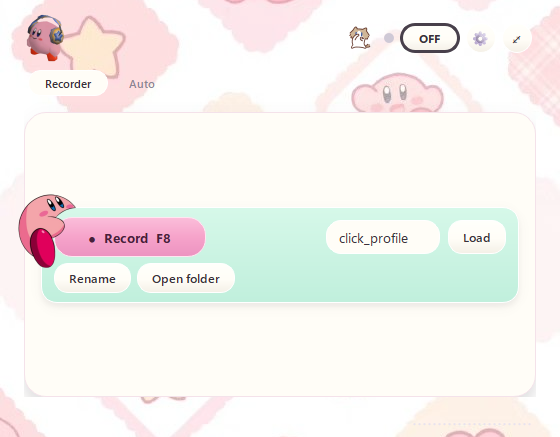

# Kirby Clicker

A small Windows clicker with Kirby mascots. Record your own clicking rhythm or
choose an automatic clicking speed.

**Turn it ON, hold your mouse button to click, and release to stop.**

## Download

1. Open the [latest release](https://github.com/Hankeei/Kirby-Clicker/releases/latest).
2. Download **KirbyClicker.exe** under **Assets**.
3. Double-click it to open. No installation or Python required.

For Windows 10/11. The app is unsigned, so Windows may show a security warning.
Only run a copy from a source you trust.

## Start clicking

### Auto-click

1. Open the **Auto** tab.
2. Choose a timing method and your clicks per second (**CPS**).
3. Press **F9** or click **OFF** to turn the clicker **ON**.
4. Move your cursor where you want to click, then **hold the left mouse button**.
5. Release to stop clicking. Press **F9** again to turn it OFF.

The app starts OFF each time. Turning it ON prepares it to click; clicking starts
only while you hold the trigger button.

### Record and replay

1. Open the **Recorder** tab.
2. Press **F8**, click at your own pace, then press **F8** again to finish.
   Your recording saves automatically.
3. Select a recording and click **Load**.
4. Turn the clicker ON and hold your mouse trigger to replay it.
   Release to stop.

Recordings repeat while you hold the trigger. They replay your rhythm at the
**current cursor position**; they do not remember where you clicked.

Use **Rename** or **Open folder** in the **PROFILES** card to manage recordings.

## Shortcuts

| Default | Action |
| --- | --- |
| **F8** | Start / stop recording |
| **F9** | Turn ON / OFF |
| **Hold left mouse button** | Click while ON; release to stop |
| **F12** | Stop and turn OFF; quit when idle |
| **F10** | Pick a target app when using selected-app scope |
| **Insert** | Change shortcuts and the trigger button |

Change these in **Settings → Edit binds…**.

## Make it yours

- **Timing:** Random varies the rhythm; Gaussian, Poisson and Gaussian + Poisson
  offer other patterns. Static keeps a steady pace.
- **Mouse button:** Choose left, right or middle.
- **Selected app:** Restrict clicking to one app through Settings.
- **Compact:** Use the compact button to switch to a small always-on-top control.
- **Music:** Change background music and volume in Settings. Music starts enabled
  at low volume and plays independently of ON/OFF.
- **Dry run:** Preview Recorder playback without sending clicks. This does not
  apply to Auto mode.

## Helpful notes

- Some games and protected apps may block automated clicks or shortcuts.
- If a shortcut does not respond, check whether another app uses it or change it.
- The Background click option works in some apps; try Foreground if clicks are ignored.
- Static mode currently clamps typed values above 30 CPS back to 30.
- The compact control can cover and intercept clicks in a small area; move it aside.

The downloaded app stores your settings and recordings in
`%LOCALAPPDATA%\KirbyClicker`. **Open folder** takes you to your recordings.
Older GMK / Record Clicker profiles remain supported.

---

Building or maintaining the app? See [DEVELOPER.md](DEVELOPER.md).
